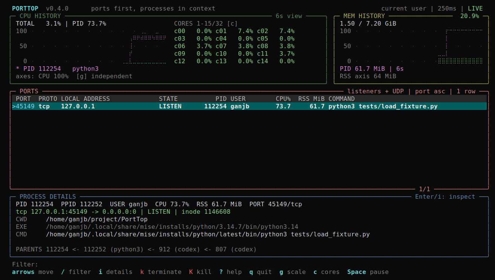

# PortTop

**Ports first. Processes in context.**

**English** | [简体中文](README.zh-CN.md)

[](https://github.com/cossoledad/PortTop/actions/workflows/ci.yml)
[](LICENSE)


A terminal monitor for local development: find a port, inspect its process, and stop the right service—even when a launcher or supervisor sits in between. Written in C with ncursesw, with an interface inspired by [btop](https://github.com/aristocratos/btop).



*A local demo service under load.*

- **Start with a port.** TCP/UDP, IPv4/IPv6, filtering and sorting.
- **See the context.** Commands, working directories, parent chains and scrollable process details.
- **Watch the load.** CPU and memory histories, per-core meters and selected-process overlays.
- **Stop with a preview.** Confirm termination of a process or a reviewed subtree. Your processes by default; all visible users when run as root.

## Install

On Ubuntu, install the build dependencies, then install PortTop for your user:

```sh
sudo apt install git build-essential pkg-config libncursesw5-dev
git clone https://github.com/cossoledad/PortTop.git
cd PortTop
./install.sh
export PATH="$HOME/.local/bin:$PATH"
porttop
```

Keep the checkout for upgrades with `porttop-update`. Uninstall with `./install.sh --uninstall`. See the [installation guide](docs/install.en.md) for custom paths and details.

Linux with `/proc` and ncursesw is required; Linux 5.3+ enables pidfd-based termination. Use a terminal of at least 80 × 24, preferably 120 × 36.

## Use

```sh
porttop --port 18080       # Find a local port
porttop --filter python    # Filter by command, PID, user or address
porttop --json             # Export a snapshot
```

| Key | Action |
| --- | --- |
| ↑ / ↓ | Select a port and process |
| `/` · `s` | Filter · change sort order |
| Enter / `i` | Inspect process details; scroll with the mouse or keyboard |
| `k` · `K` | Confirm SIGTERM · SIGKILL; choose a parent or subtree in the dialog |
| `c` · `g` | Page CPU cores · switch graph scales |
| Space · `?` · `q` | Pause · help · quit |

See the [usage guide](docs/usage.md) for all controls, graph scales and process-tree behavior.

## Contribute

Bug reports and contributions are welcome. See [CONTRIBUTING.md](CONTRIBUTING.md) for building, testing and project internals.

Released under the [MIT License](LICENSE).
