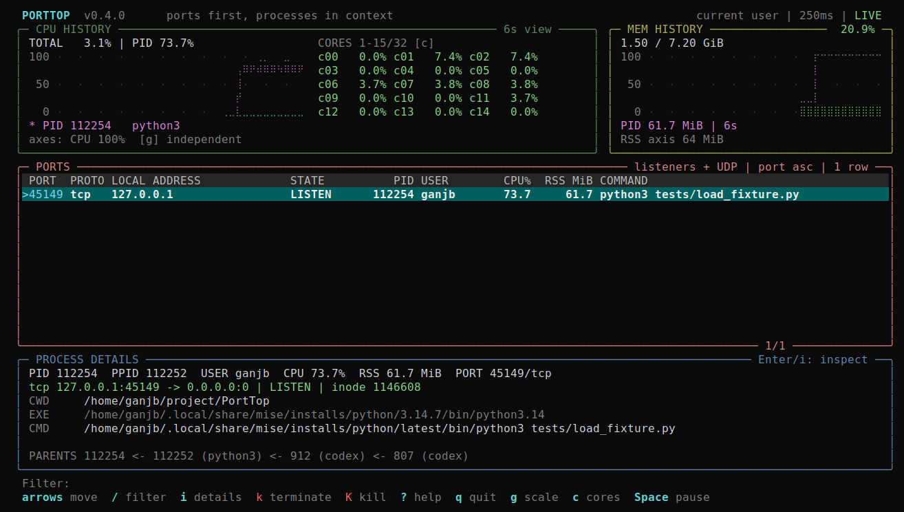

# PortTop

**从端口出发，看清进程。**

[English](README.md) | **简体中文**

[](https://github.com/cossoledad/PortTop/actions/workflows/ci.yml)
[](LICENSE)


面向本地开发的终端监视器：找到端口、查看进程，沿启动链定位并停止服务，适用于脚本或 supervisor 管理的多个服务。使用 C 和 ncursesw 编写，界面参考 [btop](https://github.com/aristocratos/btop)。



*本地演示服务的实际负载画面。*

- **以端口为入口**：TCP/UDP、IPv4/IPv6，支持筛选与排序。
- **看清启动上下文**：命令、工作目录、父进程链，以及可滚动的独立详情窗。
- **观察实时负载**：CPU 与内存历史、逐核仪表、选中进程的叠加曲线。
- **预览后再终止**：确认进程或子树的影响范围；默认只显示自己的进程，以 root 运行时显示所有可见用户。

## 安装

Ubuntu 上安装编译依赖后，将 PortTop 安装到当前用户目录：

```sh
sudo apt install git build-essential pkg-config libncursesw5-dev
git clone https://github.com/cossoledad/PortTop.git
cd PortTop
./install.sh
export PATH="$HOME/.local/bin:$PATH"
porttop
```

保留源码目录，后续运行 `porttop-update` 升级；使用 `./install.sh --uninstall` 卸载。自定义路径与更多说明见 [安装指南](docs/install.md)。

需要 Linux、`/proc` 和 ncursesw；基于 pidfd 的终止操作需要 Linux 5.3+。终端至少 80 × 24，建议 120 × 36。

## 使用

```sh
porttop --port 18080       # 查找本地端口
porttop --filter python    # 按命令、PID、用户或地址筛选
porttop --json             # 导出快照
```

| 按键 | 操作 |
| --- | --- |
| ↑ / ↓ | 选择端口与进程 |
| `/` · `s` | 筛选 · 切换排序 |
| Enter / `i` | 查看进程详情，支持滚轮和键盘滚动 |
| `k` · `K` | 确认 SIGTERM · SIGKILL；弹窗内可选择父进程或子树 |
| `c` · `g` | 翻页查看逻辑核 · 切换图表刻度 |
| Space · `?` · `q` | 暂停 · 帮助 · 退出 |

完整按键、图表刻度和进程树操作见 [使用指南](docs/usage.zh-CN.md)。

## 参与贡献

欢迎反馈问题和提交改进。构建、测试与项目结构见 [开发指南](docs/development.md)。

采用 [MIT License](LICENSE)。
